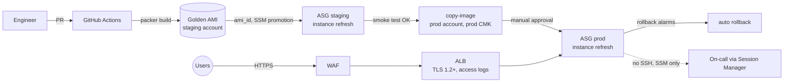

# aws-ec2-asg-golden-ami

Immutable EC2 fleet on AWS: a golden AMI pipeline (Packer) and an Auto Scaling group that rolls
out new images with zero downtime and rolls them back automatically when the alarms say so.

It is built for workloads that cannot be containerized yet: stateful-ish legacy services that still
run on virtual machines and need the same release discipline as everything else.

> **Verification status.** This repository has not been applied to a real AWS account. Everything
> below was verified locally with static checks (`terraform fmt`, `validate`, TFLint with the AWS
> ruleset, Checkov, `packer validate -syntax-only`, shellcheck, actionlint) and with unit tests for
> the sample application. Account IDs, domains and the state bucket are placeholders
> (`111111111111`, `222222222222`, `acme-demo.dev`, `acme-tfstate-111111111111`).

## The problem

Legacy VM fleets usually drift. Packages are installed by hand or by a playbook run on a schedule,
the running state differs from what was tested, patching a CVE means touching hundreds of machines,
and rollback means reinstalling an old version and hoping. Each of these problems gets worse with
fleet size, and none of them is a tooling problem alone.

This repo takes the opposite position. The unit of deployment is an AMI. Every AMI is built from
code, scanned, deployed to staging, verified and copied to production. Running instances are
replaced, never repaired. Rollback is a deployment of the previous image, and the infrastructure
makes that rollback automatic when the error rate or latency regresses.

## Architecture



The detailed diagrams (network, release sequence, rollback sequence, instance internals) are in
[docs/architecture.md](docs/architecture.md).

## Features and why they are built this way

- **Golden AMI, built from code.** Amazon Linux 2023 latest, OS updates applied at build time,
  CIS-aligned hardening (sysctl, unused filesystems and protocols disabled, `su` restricted to
  `wheel`, auditd rules, no core dumps, SSH daemon policy), CloudWatch agent, and the application
  as a hardened systemd unit. The image carries its git SHA, base AMI and build date as tags, so
  every running instance can be traced to a commit. See [ADR-0001](docs/adr/0001-immutable-amis-over-in-place-configuration.md).
- **Trivy gate in the build.** The build scans the root filesystem for fixable HIGH and CRITICAL
  findings and fails if any exist. The Trivy RPM is verified against a pinned SHA-256 before it runs.
- **No SSH, no keys, no bastion.** Packer connects through Session Manager. Instances have no
  inbound rules and no public IPs; `sshd` is disabled at boot and has no host keys in the image.
  See [ADR-0002](docs/adr/0002-session-manager-over-ssh-and-bastion.md).
- **IMDSv2 only, hop limit 1.** Enforced in the launch template and in the Packer build.
- **Encrypted everything with a customer managed key.** EBS roots, the CloudWatch log group, the
  alert topic and the AMI snapshot share one per-environment key with rotation enabled.
- **Zero-downtime rolling refresh.** `min_healthy_percentage = 90`, a checkpoint at 50% that pauses
  for ten minutes, and `auto_rollback = true`. See [ADR-0003](docs/adr/0003-instance-refresh-over-blue-green-asg.md).
- **Automatic rollback driven by user-facing signals.** Two alarms feed the refresh:
  ALB target 5xx rate above 5% and p95 target response time above one second. Unhealthy-host
  alarms are deliberately excluded: they fire during every normal refresh.
- **Graceful drain on every exit path.** An ASG termination lifecycle hook and a Spot interruption
  notice both trigger `systemctl stop sample-app`. The app fails its health check, drains
  in-flight requests, and only then does the hook complete. The application keep-alive timeout
  (75 s) is longer than the ALB idle timeout (60 s), which prevents a class of intermittent 502s.
- **Mixed on-demand and Spot.** Production keeps a two-instance on-demand base and buys Spot above
  it with `capacity-optimized` allocation across four same-size instance families. Staging runs
  about 80% Spot. See [ADR-0004](docs/adr/0004-mixed-instances-spot-strategy.md).
- **Load balancer hardening.** HTTPS listener with a TLS 1.2+ policy, HTTP to HTTPS 301 redirect,
  invalid header fields dropped, strictest desync mitigation, access logs to a private S3 bucket
  with a lifecycle rule, and deletion protection in production.
- **WAF in front of the ALB.** AWS managed Common, Known Bad Inputs (includes Log4j) and IP
  reputation rule groups, an anonymous IP group in count mode, a per-IP rate limit, and logging
  with `authorization` and `cookie` headers redacted.
- **Scaling on both CPU and requests.** Target tracking on average CPU and on ALB requests per
  target. A scheduled action in production scales up for weekday mornings and down overnight.
- **Warm pool (optional).** Pre-initialized stopped instances for faster scale-out.
- **Patch compliance, not patch-in-place.** An SSM patch baseline (security and important fixes after
  seven days), a patch group association, and a weekly maintenance window that scans for missing
  patches. Remediation is always a rebuilt AMI.
- **Least-privilege instance role.** `AmazonSSMManagedInstanceCore`, log writes to one log group,
  `PutMetricData` restricted by namespace condition, `CompleteLifecycleAction` on its own group only,
  and optional read access to named S3 prefixes.
- **Observability and SLOs.** Log groups with a one-year retention, VPC flow logs, CloudWatch agent
  metrics, alarm notifications over an encrypted SNS topic, and [SLOs with an error budget policy](docs/slo.md).
- **Optional AWS Backup** for volumes tagged `Backup=daily`. Off by default, because the fleet is stateless.

## Repository layout

```text
.
├── app/                              sample-app: stdlib-only Go service with /health, drain, tests
│   ├── cmd/sample-app/               main: wiring only
│   └── internal/{config,server}/     config parsing; HTTP handlers, drain logic, tests
├── packer/                           golden AMI template
│   ├── aws-golden-ami.pkr.hcl        source, build, manifest post-processor
│   ├── variables.pkr.hcl             validated inputs
│   ├── files/                        systemd units, drain hook, agent config, sysctl, audit rules
│   └── scripts/                      10 baseline, 20 hardening, 30 observability, 40 app,
│                                     50 Trivy gate, 90 finalize
├── terraform/
│   ├── modules/asg-service/          reusable module: ALB, WAF, ASG, launch template, scaling,
│   │                                 alarms, patching, KMS, IAM, optional backup
│   └── envs/{staging,prod}/          VPC (terraform-aws-modules/vpc) plus one module call each
├── scripts/                          CI helpers: AMI ID, AMI copy, refresh wait, smoke test
├── .github/
│   ├── workflows/terraform.yml       infrastructure, through the shared reusable workflow
│   ├── workflows/release.yml         app and AMI pipeline, staging deploy, prod copy and deploy
│   ├── actions/deploy-env/           apply, wait for refresh, smoke test, promote SSM parameter
│   ├── dependabot.yml, pull_request_template.md
├── docs/
│   ├── architecture.md               Mermaid diagrams and sequences
│   ├── adr/                          0001 to 0004, MADR format
│   ├── runbooks/                     rollback, stuck refresh, 502s, emergency access and CVE patching
│   └── slo.md                        SLIs, SLOs, error budget policy, burn-rate alerts
├── Makefile                          make lint runs every check that does not need AWS
├── .tflint.hcl  .checkov.yaml  .pre-commit-config.yaml  .editorconfig  .gitignore
└── CODEOWNERS  LICENSE
```

## Build and check locally

Requirements: Go 1.24, Packer 1.11 or newer (tested with 1.16.2), Terraform 1.10 or newer
(tested with 1.12.0), TFLint, Checkov, shellcheck, actionlint. No AWS credentials are needed for
the checks.

```bash
make help          # list targets
make app-test      # gofmt, vet, race tests with coverage
make app-build     # static linux/amd64 binary into app/bin/
make lint          # everything else: shellcheck, actionlint, packer validate, terraform fmt
                   # and validate, tflint, checkov
make clean
```

`pre-commit install` runs the same checks on every commit. The hooks are pinned.

## Deploy

### One-time bootstrap

1. Create the Terraform state bucket (outside this repo) and put its name in both
   `terraform/envs/*/backend.hcl`. The configs already set `use_lockfile = true`.
2. Create a GitHub OIDC role per account (`AWS_ROLE_ARN_STAGING`, `AWS_ROLE_ARN_PROD`). Its trust
   policy should be limited to this repository and the matching GitHub environment.
3. Set repository variables: `AWS_ROLE_ARN_STAGING`, `AWS_ROLE_ARN_PROD`, `AWS_ACCOUNT_ID_PROD`,
   `SERVICE_DOMAIN_STAGING`, `SERVICE_DOMAIN_PROD`.
4. Create GitHub environments `staging` and `prod`. Add required reviewers to `prod`.
5. Create the KMS key and alias first, because the Packer build encrypts with the alias. From a
   workstation with staging credentials:
   ```bash
   cd terraform/envs/staging
   terraform init -backend-config=backend.hcl
   terraform apply -target=module.service.aws_kms_key.this -target=module.service.aws_kms_alias.this
   ```
6. Run `release-ami` with `workflow_dispatch`. It builds the first AMI, deploys staging with the
   refresh and smoke test, and writes the promoted AMI to SSM. Approve the prod job when staging
   passes.
7. From then on, merges to `main` run both pipelines. `terraform.yml` reads the promoted AMI from
   SSM when the pipeline does not pass one, so infrastructure changes never revert a release.
   Until step 6 has written the parameter, plans without an AMI fail with a clear missing-parameter
   error. That is the intended behavior.

### Release (every change to the app or the image)

1. Open a PR. `release.yml` runs the app tests, shellcheck and the Packer syntax checks.
2. Merge to `main`. The workflow builds the AMI in the staging account. Packer scans it with Trivy
   and records the AMI ID in the manifest.
3. `terraform apply -var ami_id=<new AMI>` changes the launch template. The ASG runs an instance
   refresh. The job waits for it, then runs the smoke test (health, version matches the commit,
   HTTP to HTTPS redirect). If the rollback alarms fire, the refresh rolls back and the job fails.
4. The SSM parameter for the environment is updated only after the smoke test passes.
5. The prod job waits for approval, copies the AMI into the production account with the production
   key, applies it, waits for the refresh, runs the smoke test and promotes it.

### Infrastructure

`terraform.yml` calls the shared reusable workflow for `terraform/envs/staging` first and then
`terraform/envs/prod`. The reusable workflow runs fmt, init, validate, TFLint and Checkov on pull
requests and applies on pushes to `main`.

## Cost estimate

Monthly, us-east-1, at list prices at the time of writing. These are rough numbers for planning,
with roughly ±25% accuracy. They exclude data transfer beyond the notes and taxes. Check them with
the AWS Pricing Calculator before using them for a budget.

| Item | Staging | Production (baseline, 3 instances) | Notes |
| --- | ---: | ---: | --- |
| EC2 instances (m7i.large class) | $40-60 | $150-190 | Prod: 2 on-demand base plus Spot. Staging: about 80% Spot |
| NAT gateway | $33 | $99 (3 gateways) | Biggest surprise. Prod uses one per AZ. See next steps |
| Application Load Balancer | $22 | $25 | Fixed hourly charge plus LCUs |
| AWS WAF (ACL, 5 managed groups, rate rule) | $12 | $12 | Plus $0.60 per million requests |
| KMS customer managed keys | $1 | $1 | One per environment, plus requests |
| CloudWatch (logs, custom metrics, alarms) | $10 | $25 | One-year retention for logs drives storage |
| VPC flow logs | $5 | $10 | Depends on traffic volume |
| EBS root volumes (20 GiB gp3 each) | $3 | $6 | Warm pool stopped instances add volume cost only |
| S3 (ALB access logs) | <$1 | $2 | 90-day lifecycle |
| AWS Backup (optional, off by default) | $0 | $5 | Only tagged volumes |
| **Approximate total** | **$130-160** | **$330-380** | Scales with traffic and instance count |

## Security posture

- **Identity:** CI uses OIDC roles, with no long-lived keys in GitHub. Operator access is through
  IAM roles, with break-glass requiring MFA. Production changes need a manual approval.
- **Network:** no inbound access to instances. The ALB is the only public entry point. Egress from
  the private subnets is limited to HTTPS and NTP. VPC flow logs are on.
- **Compute:** IMDSv2 with hop limit 1. Encrypted EBS with a CMK. No SSH keys, no host keys,
  `sshd` disabled at boot. Auditd logs shipped to CloudWatch. The application runs as an
  unprivileged user with a systemd sandbox (no capabilities, read-only filesystem except its log
  directory, no namespaces, no writable-and-executable memory).
- **Supply chain:** pinned Packer plugin and Terraform provider versions with a committed lock
  file. Trivy RPM verified by SHA-256. Dependabot for actions, Go modules, Terraform and hooks.
- **Edge:** WAF managed rules, a per-IP rate limit, TLS 1.2+ policy, invalid header fields dropped,
  strictest desync mitigation, redacted WAF logs.
- **Policy as code:** Checkov runs with zero failures and 16 inline skips. Each skip names a real constraint,
  for example KMS key-policy `"*"` resources, ALB access logs that cannot use SSE-KMS, the port 80
  redirect listener, or a registry module source that has no commit hash. TFLint runs the recommended Terraform rules and the AWS ruleset.
- **Secrets:** none in the repo. Account IDs, domains and role ARNs are variables or placeholders.

## What I'd do next

1. **Burn-rate alarms.** Implement the multi-window alerts in [docs/slo.md](docs/slo.md) with metric
   math. They are not in the module yet.
2. **Remove NAT from the hot path.** Interface endpoints for SSM, CloudWatch Logs and STS, plus a
   gateway endpoint for S3, cut NAT data charges and remove internet dependence from the control
   plane. This is the largest cost change.
3. **Bake time and canaries.** Use the refresh `BakeTime` preference so a new version runs with
   traffic for a fixed period before the next batch.
4. **Load test the rollback.** A scheduled k6 run in staging that injects 5xx responses. A rollback
   path that has never fired is untested.
5. **Continuous image scanning.** Amazon Inspector v2 on the promoted AMIs, to catch CVEs published
   after the build.
6. **Signed artifacts.** Sign the AMI manifest and the app binary, and verify the signature in the
   copy step.
7. **Bootstrap module.** State bucket, OIDC roles and the KMS alias as their own Terraform root, so
   the bootstrap steps above become a single apply.
8. **Route 53 and certificates.** Manage the service domain and the ACM certificate in the same
   root instead of passing an ARN.

## License

MIT. See [LICENSE](LICENSE).
