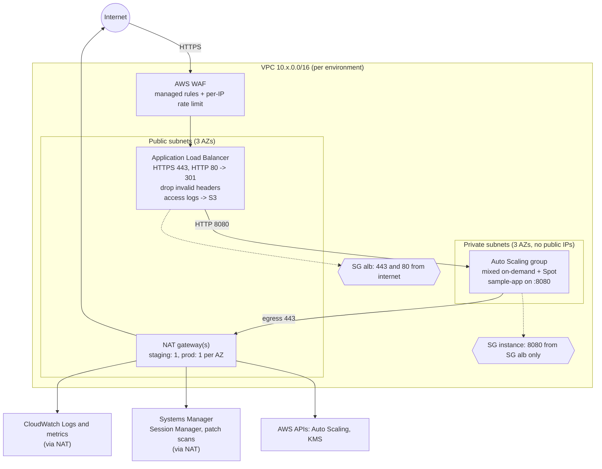
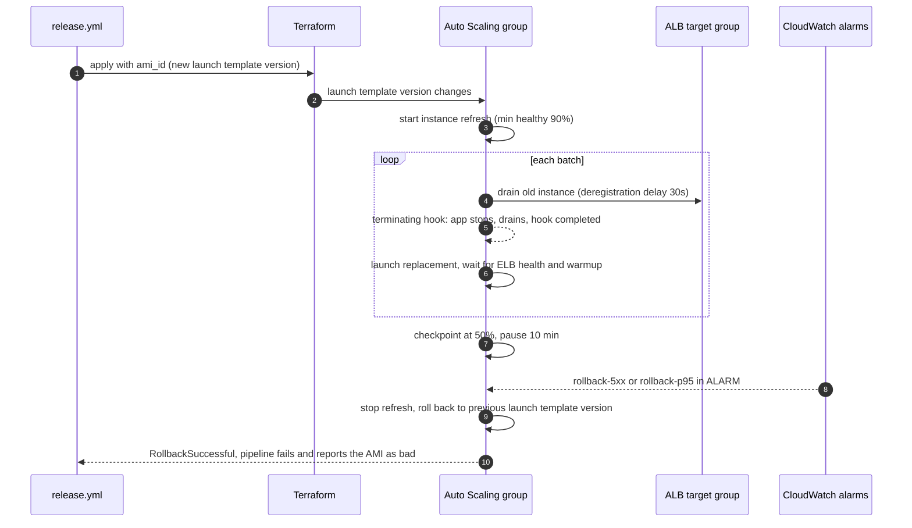
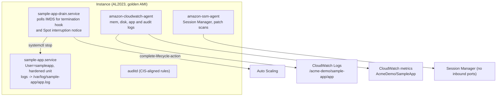

# Architecture

This document describes how the fleet is laid out and how a change travels from a commit to
running instances. The decisions behind these choices are in [`adr/`](adr/).

## Network

Each environment has its own VPC in its own AWS account (staging `111111111111`, production
`222222222222`). Three availability zones, public subnets for the load balancer, private subnets
for the instances. Instances never have a public IP and accept no inbound traffic except from the
load balancer.

Egress from the private subnets goes through NAT. The instances need outbound HTTPS for Systems
Manager, CloudWatch and package repositories, and NTP to the link-local time service. VPC
endpoints for Systems Manager and CloudWatch would remove NAT data charges and are the first
production optimization listed in the README.

## Release flow: AMI to fleet

The fleet runs only images that have been built, scanned, deployed to staging, verified and then
copied into production. Nothing is patched on a running instance.

```mermaid
flowchart LR
  pr["Pull request<br/>app/, packer/, scripts/"] --> checks["Checks<br/>go test -race, shellcheck,<br/>packer fmt and validate"]
  checks -->|merge to main| build["Packer build (staging account)<br/>AL2023 latest, hardening,<br/>CloudWatch agent, app unit,<br/>Trivy HIGH/CRITICAL gate"]
  build --> ami[("Golden AMI<br/>encrypted with CMK")]
  ami --> stage_tf["terraform apply (staging)<br/>-var ami_id=ami-..."]
  stage_tf --> refresh_s["ASG instance refresh<br/>90% min healthy, checkpoint 50%"]
  refresh_s -->|alarms green| smoke_s["Smoke test via ALB<br/>/health, /version, HTTP 301"]
  refresh_s -->|rollback alarm| rb["Automatic rollback<br/>previous launch template"]
  smoke_s -->|pass| promote_s["SSM /…/staging/ami-id<br/>updated"]
  promote_s --> approval{{"Manual approval<br/>(prod environment)"}}
  approval --> copy["copy-image into prod account<br/>encrypted with prod CMK"]
  copy --> stage_p["terraform apply (prod)"]
  stage_p --> refresh_p["Instance refresh"]
  refresh_p -->|alarms green| smoke_p["Smoke test, promote prod SSM"]
  refresh_p -->|rollback alarm| rb
```

Two pipelines split the work:

- `release.yml` owns the artifact. It builds the AMI, moves it between accounts and deploys it.
- `terraform.yml` owns the infrastructure. It plans and applies module and environment changes
  through the shared reusable workflow.

Both read the same promoted AMI ID from SSM Parameter Store, so an infrastructure apply never
silently reverts a release, and a release never silently changes infrastructure.

## Rollout and automatic rollback

An AMI change creates a new launch template version. The ASG then runs an instance refresh:

1. Replace instances in batches while keeping at least 90% of the group healthy.
2. Pause at 50% for 10 minutes (checkpoint) so the alarms can observe the new version under load.
3. If the rollback alarms go to ALARM at any point, stop and restore the previous launch template
   version automatically (`auto_rollback = true`).

The rollback alarms measure the fleet's 5xx rate and p95 latency from the ALB. Unhealthy host
alarms are deliberately excluded from rollback, because replaced instances are briefly unhealthy
during a normal refresh. See [ADR-0003](adr/0003-instance-refresh-over-blue-green-asg.md).

## Instance internals

## Module layout

| Path | Purpose |
| --- | --- |
| `terraform/modules/asg-service` | Reusable service module: ALB, WAF, ASG, launch template, scaling, alarms, patching, optional backup |
| `terraform/envs/staging`, `terraform/envs/prod` | Root configurations: VPC (terraform-aws-modules/vpc) plus one module call each |
| `packer/` | Golden AMI template and provisioning scripts |
| `app/` | sample-app, a stdlib-only Go service with graceful drain |
| `scripts/` | CI helpers: AMI ID extraction, AMI copy, instance refresh wait, smoke test |
| `.github/actions/deploy-env` | Shared deploy steps: apply, wait for refresh, smoke test, promote |
